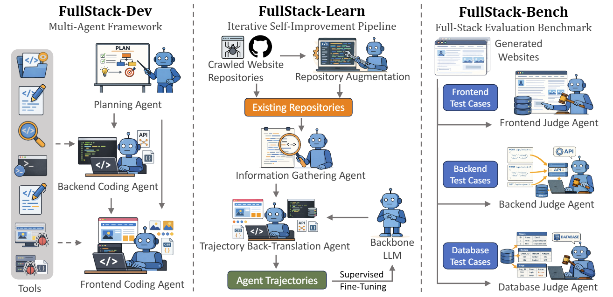
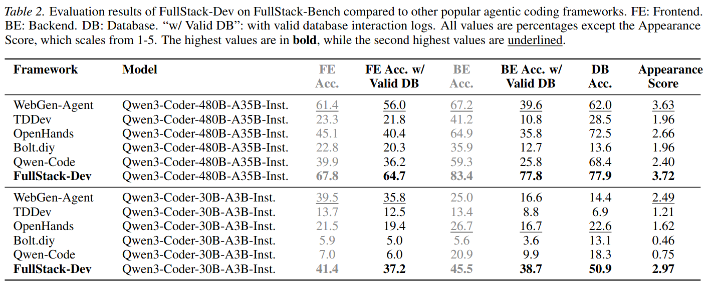
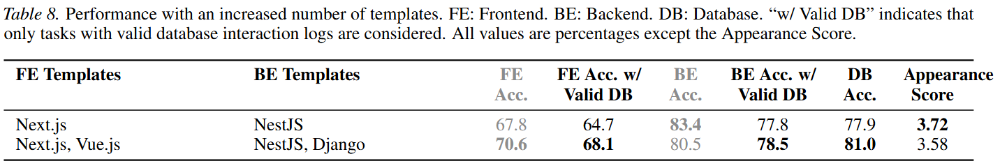

# FullStack-Dev

## Update
This work did not previously support reasoning models such as the new OpenAI models.
I found it necessary to add support for reasoning models due to their superior ability to generate code and planning.
Additionally, not everyone has the capability to run large models locally as was done in this work.

I have updated the code and the readme to support the new OpenAI models such as GPT-6-Astra, etc.
You still need to add your own OpenAI API key in the .env file.

You also still need to review `data/new-site.jsonl` and update your instructions for the agent to work properly.

The agents will iterate 400 times to generate the website. However, you can still change the number of iterations in the run_batch.sh file.

This project is ready to run after you update the instruction to match your website in the jsonl file, all what you need is to run the `src/run/run_batch.sh`, but before you run it do not forget to update your working root and log root paths in the run_batch.sh file.
```bash
WORKING_ROOT=""
LOG_ROOT=""
```

Good luck and have fun!


### Overview

This is a repository for the multi-agent framework (FullStack-Dev) described in the paper ["FullStack-Agent: Enhancing Agentic Full-Stack Web Coding via Development-Oriented Testing and Repository Back-Translation"](https://arxiv.org/abs/2602.03798). It develops full-stack websites from scratch using a multi-agent mechanism and efficient coding tools. In particular, its specially designed frontend and backend debugging tools are good at locating obscure bugs in the website codebase. The Repository Back-Translation and Repository Augmentation code of FullStack-Learn is also in this repository.



### Installation

Run the following commands:

```bash
# install python dependencies
git clone https://github.com/mnluzimu/FullStack-Dev.git
cd FullStack-Dev
conda create -p env/webgen2 python=3.12 -y
conda activate env/webgen2
pip install -r requirements.txt

# install Node.js, chrome, and check selenium
bash install_node_chrome/install.sh
```

### Running Agents

The scripts for running the FullStack-Dev agents are placed in `src/run/`. There are two ways to configure the templates:

1. In `src/run/run_batch.py`, the code uses classes in `src/core/`, which uses templates with coupled frontend-backend implementation (meaning that one template contains both frontend and backend). Most of our experiments use the `nextjs-nestjs-postresql`, as using more templates would increase instability, since a slight shift in template choice tendencies could significantly affect the results, making the comparisons of the experiment results less reliable. However, you can define your own templates by configuring `TEMPLATES` in `src/core/templates.py`, and placing the template in `templates/`. This mode applies to the case when the frontend and backend have preferred combinations and should not be randomly combined.

```bash
# Coupled templates
bash src/run/run_batch.sh
```

2. In `src/run/run_batch_decoupled.py`, the code uses classes in `src/core_decoupled/`, which have decoupled frontend and backend templates, and the agent would choose a frontend template and a backend template, and automatically combine them together. You can define the templates in `templates_decoupled/`. Each of your frontend templates should have the `dev` and `script:install` scripts defined in `package.json`. The config files of the new templates should be added in `templates_decoupled/config/` as well. Currently, there are frontend templates [Next.js](https://nextjs.org/) and [Vue.js](https://vuejs.org/), and backend templates [NestJS](https://nestjs.com/) and [Django](https://www.djangoproject.com/).

```bash
# Decoupled templates
bash src/run/run_batch_decoupled.sh
```

### OpenAI reasoning models (including GPT-6 Astra)

The shared adapter in `src/model_api.py` routes GPT-5, GPT-6, o1, o3, and o4
model IDs to the Responses API. The planning, coding, compression and image
requests all use this adapter. Other OpenAI-compatible models (including Qwen)
continue to use Chat Completions. The installed `openai==1.104.2` SDK supports
the Responses fields used here; the offline tests exercise that version.

**Credentials and settings**

Merge the settings you need from `.env.openai.example` into your existing `.env`.
Do not replace an existing `.env` with the example. `OPENAI_API_KEY` and optional
`OPENAI_BASE_URL` are supported; existing `OPENAILIKE_API_KEY` / `OPENAILIKE_BASE_URL`
settings also work. A native key takes priority over its legacy counterpart,
and each key is paired only with its matching endpoint. Anthropic credentials
are only required when selecting an Anthropic model.

The browser tester still selects its model using `VLM_MODEL`. Its credential
priority is `OPENAI_VLM_*`, `OPENAILIKE_VLM_*`, `OPENAI_*`, then `OPENAILIKE_*`.
Numbered clients use matching suffixed names such as `OPENAILIKE_VLM_API_KEY0`
and `OPENAILIKE_VLM_BASE_URL0`. Your existing browser-model choice is preserved;
you can set `VLM_MODEL=gpt-6-astra` if you want Astra for browser testing too.

- `LLM_API_MODE` / `VLM_API_MODE`: `auto` (default), `responses`, or `chat_completions`.
  Use `responses` for a gateway's custom model alias. The endpoint must implement
  `/v1/responses`; a Chat-only gateway cannot run Astra's reasoning with tools.
- `OPENAI_REASONING_EFFORT`: defaults to `medium`. Astra accepts `low`, `medium`,
  `high`, `xhigh`, or `max`; it does not accept `none`.
- `OPENAI_MAX_OUTPUT_TOKENS`: optional output budget, including reasoning tokens.
  Start with `32768`. When set it overrides the agents' legacy `max_tokens` values;
  an explicit `max_output_tokens` argument takes precedence. Without it the legacy
  per-call limit is used, or 32768 if no limit was provided.

Reasoning requests omit unsupported sampling parameters. The adapter maps tools,
results, images and JSON response formats to Responses. It preserves complete
response output, encrypted reasoning and assistant phase in `_response_output`
on assistant history records. Keep that field when saving/resuming runs. History
compression excludes this metadata from summary text and retains complete recent
tool/result groups. Incomplete output is rejected before any tool executes.
Permanent API errors stop the run, while context-limit errors trigger compression.

**Planning output-limit recovery**

Astra planning uses a separate initial output budget of 65,536 tokens, including
reasoning, and retries at most once after output exhaustion, capped at the model's
128,000-token limit. It keeps `OPENAI_REASONING_EFFORT` unchanged. The planner
requests concise JSON with shared type definitions instead of repeating deeply
nested schemas and the entire test specification. Coding agents still receive
the complete original requirements.

Optional settings in `.env`:

```dotenv
OPENAI_PLANNING_MAX_OUTPUT_TOKENS=65536
OPENAI_PLANNING_RETRY_MAX_OUTPUT_TOKENS=128000
```

These settings apply to planning requests and override the general
`OPENAI_MAX_OUTPUT_TOKENS` value for that stage. To impose a smaller hard cap, set
both planning values to that cap; the planner stops if it cannot increase the
budget. Automatic Astra defaults do not apply to other model families or custom
aliases. Those keep their existing limits unless explicit planning settings are
provided. Qwen and Anthropic retain their legacy request parameters.

There are at most two planning requests in total, including malformed-plan
recovery. Larger budgets and retries can increase latency and API charges.
Incomplete output is never accepted as a plan or executed as tool calls. Planning
error logs include the requested budget, actual output/reasoning token counts
when available, and visible text length. Successful responses also log token usage.
This permits distinguishing reasoning-budget exhaustion from oversized visible
plans without exposing private reasoning.

**Run from the repository root**

The coupled launcher defaults to Astra and a new `openai-responses` tag so it
uses a separate output directory from the earlier failed runs:

```bash
MODEL=gpt-6-astra bash src/run/run_batch.sh
```

The separate-template runner also supports the adapter through its Python entry
point (`src/run/run_batch_decoupled.py --model gpt-6-astra` plus your usual paths
and input file). Its legacy shell launcher still contains machine-specific paths.

**Checks**

```bash
# Offline checks: no API calls or Docker containers
./env/webgen2/bin/python -B -m unittest discover -s tests -v

# Optional: two small billable requests, no code execution or website generation
./env/webgen2/bin/python -B src/run/check_openai.py --model gpt-6-astra --live
```

The offline suite covers serialized tool/reasoning replay, multiple calls, image
conversion, key routing, Qwen compatibility, incomplete output, history compression,
and both agent loops. A successful API smoke check does not validate the entire
Docker/browser/database website-generation workflow or imply the paper's scores
will transfer to a different backbone model.

Official references: [GPT-6 compatibility](https://developers.openai.com/api/docs/guides/latest-model),
[reasoning state](https://developers.openai.com/api/docs/guides/reasoning), and
[GPT-6 Astra](https://developers.openai.com/api/docs/models/gpt-6-astra).


Check the specification and input wiring without running the dev agent:

```bash
./env/webgen2/bin/python -B -m unittest discover -s tests -p 'test_generation_input.py' -v
```

Then generate using the normal launcher:

```bash
MODEL=gpt-6-astra bash src/run/run_batch.sh
```

Generation, browser/database checks, real provider integration and launch approval
are separate steps; editing this specification does not itself implement or
certify the generated platform.

### FullStack-Learn Data Generation

Repository Crawling:
```bash
python src/process_data/download_nestjs_github.py
python src/process_data/download_nextjs_github.py
```

Repository Back-Translation:
```bash
# Information Gathering
bash src/run_process_data/run_info_gathering.sh
python src/run_process_data/filter_github-repos.py

# Trajectory Back-Translation
bash src/run_process_data/run_trajectory_backtranslation.sh
python src/run_process_data/process_back-translated-traj.py

# Augmentation Planning
bash src/run_process_data/run_website_augmentation_planning.sh
python src/run_process_data/gather_augmentation_plans.py

# Augmentation Creating
bash src/run_process_data/run_website_augmentation_creating.sh
python src/run_process_data/gather_augmentation_created_repos.py
```

### Experimental Results

Experimental results of FullStack-Dev on [FullStack-Bench](https://github.com/mnluzimu/FullStack-Bench) compared to popular baseline methods are shown below:



The result of using more templates is presented below:



Using more templates result in better performance in most of the metrics, which might be due to the fact that with more templates to choose from, the agent can find the most appropriate and easy-to-work-with templates, thus making the development process smoother.

### Cite
If you find our project helpful, please cite:

```
@misc{lu2026fullstackagentenhancingagenticfullstack,
      title={FullStack-Agent: Enhancing Agentic Full-Stack Web Coding via Development-Oriented Testing and Repository Back-Translation}, 
      author={Zimu Lu and Houxing Ren and Yunqiao Yang and Ke Wang and Zhuofan Zong and Mingjie Zhan and Hongsheng Li},
      year={2026},
      eprint={2602.03798},
      archivePrefix={arXiv},
      primaryClass={cs.SE},
      url={https://arxiv.org/abs/2602.03798}, 
}
```